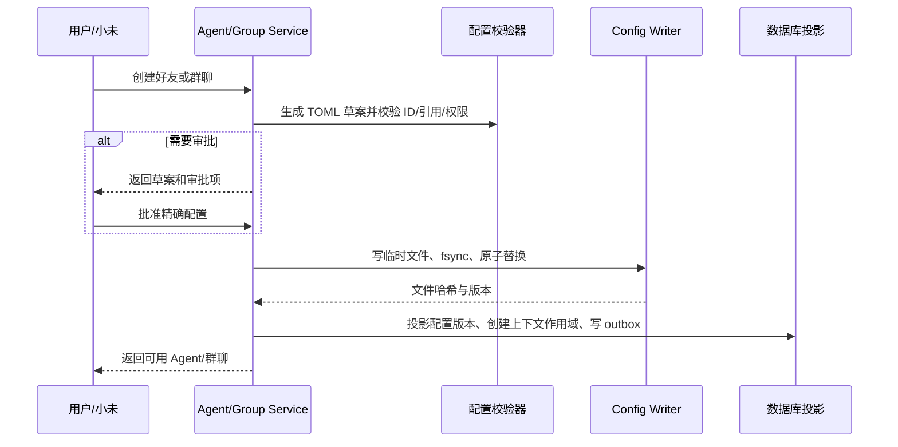

# FutureWork 工程目录设计

状态：目标工程结构，尚未对当前可运行 MVP 做目录迁移。本文重点解决两个要求：**每位 Agent 好友、每个群聊各有一份配置文件**；**Agent 私聊与群聊拥有独立、可审计的上下文管理**。配置采用 TOML，与当前 Python 3.12 项目一致，避免引入 YAML 解析依赖。

## 1. 核心原则

1. **配置文件定义身份，数据库保存运行状态。** `config/agents/<id>.toml` 和 `config/groups/<id>.toml` 是 Agent 与群聊定义的权威来源。消息、任务、审批、摘要、记忆、未读数不能写回这些配置文件，存入数据库。
2. **一个 ID 对应一个配置文件。** 文件名、文件内 `id` 和数据库投影 ID 必须相同。Agent 与群聊各用自己的命名空间；不要用展示名称、数组下标或文件路径作为运行时主键。
3. **上下文按作用域隔离。** 小未对话使用 `(workspace_id, assistant, assistant_id)`；Agent 私聊使用 `(workspace_id, agent, agent_id)`；群聊使用 `(workspace_id, group, group_id)`；任务使用短期作用域 `(workspace_id, task, task_id)`。
4. **群成员共享群上下文，不共享私聊上下文。** Agent 在群聊中可用自身角色配置和该群的历史、摘要及共享记忆；不得自动读取自己与用户的私聊，也不得读取其他群的历史。
5. **版本固定。** 配置变更产生新版本；已启动任务记录 Agent/群聊配置版本与上下文快照游标，避免执行中权限和规则悄然变化。
6. **用户创建也是创建配置。** 小未或用户在页面创建 Agent/群聊时，服务端先验证并写入对应 TOML，再同步数据库投影；高风险权限仍先走审批。

## 2. 建议目录树

```text
FutureWork/
├── README.md
├── pyproject.toml
├── uv.lock
├── .env.example                     # 环境变量名称示例；密钥不入库
├── config/
│   ├── app.toml                     # 服务、数据库、队列、限额、前端公开参数
│   ├── models.toml                  # 模型别名、供应商适配、费用/上下文窗口
│   ├── tools.toml                   # 工具注册表、风险等级、默认审批策略
│   ├── matching.toml                # 匹配权重、阈值、负载与成本参数
│   ├── planner.toml                 # 任务拆解约束、能力词典、回退规则
│   ├── runtime.toml                 # 单次运行的循环、超时、并发、重试与预算上限
│   ├── context.toml                 # 全局上下文预算、摘要、检索和保留策略
│   ├── agents/
│   │   ├── assistant.toml           # 小未；特殊 Agent，仍遵循同一配置 schema
│   │   ├── research.toml            # 知知
│   │   ├── design.toml              # 小绘
│   │   ├── code.toml                # 阿码
│   │   ├── write.toml               # 言言
│   │   └── plan.toml                # 程程
│   ├── groups/
│   │   ├── launch.toml              # 产品发布小组
│   │   ├── weekly.toml              # 每周进展同步
│   │   └── ideas.toml               # 灵感碰撞室
│   └── prompts/
│       ├── assistant.md
│       └── agents/                  # 可选长提示词；由 Agent TOML 显式引用
├── backend/
│   ├── __main__.py                  # 从 app.toml 读取监听配置并启动
│   ├── bootstrap.py                 # 加载、校验全部配置并建立数据库投影
│   ├── api/
│   │   ├── app.py                   # FastAPI 组装，不放业务规则
│   │   ├── agents.py                # Agent 查询、创建、配置修订
│   │   ├── groups.py                # 群聊查询、创建、成员变更
│   │   ├── conversations.py         # 消息、已读、会话查询
│   │   ├── tasks.py                 # 任务与步骤
│   │   ├── approvals.py             # 精确动作/配置审批
│   │   └── events.py                # SSE 及断线重放
│   ├── schemas/
│   │   ├── agent_config.py          # Pydantic：Agent TOML schema
│   │   ├── group_config.py          # Pydantic：Group TOML schema
│   │   ├── runtime.py               # 消息、任务、审批 API schema
│   │   └── config_validation.py     # 引用完整性、唯一性、路径安全
│   ├── config_store/
│   │   ├── loader.py                # 扫描 TOML、解析、哈希、版本
│   │   ├── writer.py                # 草稿、原子写入、冲突检查
│   │   └── reconciler.py            # 文件与数据库投影对账
│   ├── domain/
│   │   ├── agents.py                # Agent 身份、版本、状态机
│   │   ├── groups.py                # 成员关系、群回复策略
│   │   ├── tasks.py                 # 任务和 DAG 状态机
│   │   ├── permissions.py           # 工具和数据作用域判定
│   │   └── matching.py              # 纯 Python 能力匹配算法
│   ├── contexts/
│   │   ├── types.py                 # ScopeKey、ContextSnapshot、引用元数据
│   │   ├── assistant_context.py     # 小未对话、计划摘要与任务追踪
│   │   ├── agent_context.py         # Agent 私聊历史与私有记忆
│   │   ├── group_context.py         # 群消息、群摘要与共享记忆
│   │   ├── task_context.py          # 单次任务的临时输入和产物
│   │   ├── assembler.py             # 按权限组装模型上下文
│   │   ├── summarizer.py            # 增量摘要、回溯来源
│   │   ├── retrieval.py             # 按作用域检索；不得跨域默认搜索
│   │   └── policy.py                # 显式分享、保留与删除规则
│   ├── runtime/
│   │   ├── router.py                # 按会话类型选择三种顶层 Runtime
│   │   ├── assistant_runtime.py     # 小未对话：规划、分派、建 Agent、汇总
│   │   ├── direct_runtime.py        # Agent 私聊：单 Agent 回复与私有上下文
│   │   ├── group_runtime.py         # 群聊：成员路由、发言顺序、共享上下文
│   │   ├── agent_executor.py        # 三种 Runtime 共用的单 Agent 推理/工具循环
│   │   ├── run_spec.py              # 配置版本、上下文作用域、任务和预算快照
│   │   ├── checkpoints.py           # 运行状态持久化、恢复和取消
│   │   └── tool_dispatch.py         # 工具授权、审批与调用入口
│   ├── services/
│   │   ├── agent_service.py          # 创建配置、审批、激活、版本切换
│   │   ├── group_service.py          # 创建群、成员变更、上下文初始化
│   │   ├── message_service.py        # 消息写入、路由、事件
│   │   ├── task_service.py           # 规划、分派、执行、汇总
│   │   └── inbox_service.py          # 最近动态/全部/待审批读模型
│   ├── integrations/
│   │   ├── model_gateway.py          # 供应商协议与适配器
│   │   └── tools/                   # 工具注册、沙箱、外部服务适配器
│   ├── persistence/
│   │   ├── models.py                # SQLAlchemy 表
│   │   ├── repositories/            # Agent、Group、Context、Task 等仓储
│   │   └── unit_of_work.py          # 事务与 outbox
│   └── workers/
│       ├── task_worker.py           # 长任务、租约、重试
│       └── config_reconciler.py     # 配置文件与投影周期核对
├── frontend/
│   ├── index.html
│   ├── src/
│   │   ├── app/                    # 路由、初始化、SSE 客户端
│   │   ├── features/
│   │   │   ├── agents/              # 好友列表与配置抽屉
│   │   │   ├── groups/              # 群聊列表、成员管理
│   │   │   ├── chat/                # 聊天区和消息卡
│   │   │   ├── inbox/               # 最近/全部/待审批视图
│   │   │   └── tasks/               # 任务 DAG 与状态
│   │   └── shared/                 # API client、类型、通用组件
│   └── public/
├── migrations/                     # 数据库结构迁移
├── tests/
│   ├── config/                     # 文件 schema、引用和热更新测试
│   ├── contexts/                   # 私聊/群聊隔离测试
│   ├── domain/                     # 匹配、DAG、权限纯函数测试
│   ├── api/                        # 契约与幂等测试
│   └── e2e/                        # 页面主流程
├── scripts/                        # 开发启动、导入、备份和配置检查
├── docs/                           # 架构、接口、运维与迁移方案
└── data/                           # 本地运行数据；gitignored
```

这是**目标组织方式**。当前 MVP 的 `backend/app.py`、`backend/database.py` 和 `config/app.toml` 较集中；迁移时按业务边界拆开。`frontend/` 可先保留现有无构建页面，再逐步拆为组件，不要求一次性引入新框架。

## 3. 配置文件契约

### 3.1 Agent：一个文件定义一个好友

`config/agents/research.toml` 示例：

```toml
schema_version = 1
id = "research"
name = "知知"
role = "研究与洞察"
kind = "friend"
status = "active"
icon = "知"
color = "#e7e8fa"
ink = "#7873ad"
prompt_file = "prompts/agents/research.md"

[model]
id = "default-fast"                 # 引用 models.toml 中的别名
temperature = 0.4                   # 覆盖全局默认值；可省略

[capabilities]
"research.web" = 0.95
"analysis.summary" = 0.80

[permissions]
tools = ["web_search"]
approval_policy = "standard"       # 引用 tools.toml 中的策略
data_scopes = ["user_shared_files"]

[context]
private_memory = true
history_token_budget = 6000
summary_trigger_tokens = 4500
memory_retention_days = 180
share_to_groups = "explicit_only"

[limits]
max_concurrent_tasks = 2
daily_token_budget = 100000

[runtime]
profile = "standard"                 # 引用 runtime.toml；小未可用 orchestrator
max_turns = 8                         # 只能在全局硬上限内覆盖
```

`assistant.toml` 使用相同 schema，增加 `kind = "assistant"`、`system = true` 和规划权限；系统内恰好一个 assistant。`prompt_file` 的相对路径只能落在 `config/prompts/` 内。小型 Agent 可直接用 TOML 的 `system_prompt` 字段；长提示词用独立 Markdown 文件，仍由该 Agent 配置文件引用。

### 3.2 Group：一个文件定义一个群聊

`config/groups/launch.toml` 示例：

```toml
schema_version = 1
id = "launch"
name = "产品发布小组"
status = "active"
icon = "发"
color = "#e4ede7"
ink = "#398769"
members = ["design", "write", "plan"]

[reply]
strategy = "mention_then_facilitator"
facilitator_agent_id = "assistant"
max_parallel_responders = 1

[context]
history_token_budget = 10000
summary_trigger_tokens = 7500
shared_memory = true
memory_retention_days = 180
private_chat_import = "never"
history_visibility = "since_joined"

[permissions]
allow_member_tools = true             # 不授予新权限；仍以各 Agent 的授权为上限
external_share = "approval_required"
```

群配置只引用成员 ID，不复制成员的模型、能力或工具授权。成员不存在、处于 archived 状态、重复、或 `facilitator_agent_id` 不符合回复策略时，启动校验失败。群聊的 `allow_member_tools` 仅表示群内是否允许发起工具请求，不能覆盖 Agent 自身权限和用户对资源的授权。

### 3.3 全局配置与覆盖顺序

`app.toml` 只放全局运行参数；模型、工具、匹配、上下文各有专用文件。**生效值 = 全局默认值 → 作用域配置覆盖 → 任务级限制收紧**。任务只能收紧限额或权限，不得扩大 Agent/群权限。敏感配置（模型 API key、数据库凭证）由环境变量或密钥管理器注入；TOML 只存环境变量名称/密钥引用。

文件解析使用 `tomllib`，Pydantic schema 设置 `extra = "forbid"`，避免拼写错误被静默忽略。校验必须覆盖：schema 版本、文件名与 ID 一致、ID 唯一、模型/工具/能力引用有效、成员关系有效、上下文预算为正、风险策略不弱于全局下限、提示词路径不能越界。配置通过校验后计算内容哈希并存入 `config_versions`；热更新只对新任务生效。

### 3.4 三种对话 Runtime

三类对话需要**三个不同的顶层 Runtime**。`runtime/router.py` 根据会话类型选择其一；它们各自决定上下文、状态流转和可执行动作，共用底层的 `AgentExecutor`、模型网关、工具检查和 checkpoint 组件。这里的 Runtime 是一次会话处理的执行器，不要求为每个好友或群聊常驻一个 Python 进程。

| Runtime | 负责的会话 | 上下文作用域 | 核心职责 |
| --- | --- | --- | --- |
| `AssistantRuntime` | 用户 ↔ 小未 | `(workspace_id, "assistant", "assistant")` | 理解目标、规划、分派、创建 Agent 配置草案、跟踪和汇总任务 |
| `DirectChatRuntime` | 用户 ↔ 某个 Agent 好友 | `(workspace_id, "agent", agent_id)` | 加载该 Agent 配置和私聊上下文，完成单 Agent 回复与获准的工具调用 |
| `GroupChatRuntime` | 用户与多个 Agent 的群聊 | `(workspace_id, "group", group_id)` | 加载群配置和共享上下文，处理 @、选发言者、控制并发/顺序、汇总群内回复 |

```text
用户消息
  -> MessageRouter 读取会话类型与配置版本
     -> assistant_direct: AssistantRuntime.run(assistant_scope)
     -> agent_direct:   DirectChatRuntime.run(agent_scope)
     -> group:          GroupChatRuntime.run(group_scope)

三种 Runtime 调用共用的 AgentExecutor：
  AgentExecutor.run(agent_config_version, allowed_context, task, budget)
    -> ModelGateway -> ToolDispatch -> Checkpoint
```

**AssistantRuntime** 可以创建任务计划和子任务，但只从自己的上下文及经授权回传的任务产物中取材。它不能因“协调者”身份直接读取任意好友私聊或绕过权限审批。**DirectChatRuntime** 固定一个好友配置版本及其私有上下文，聊天内容不会写入群共享记忆。**GroupChatRuntime** 自己拥有群会话状态机和上下文管理：按群配置选出一位或多位成员，再分别调用成员的 `AgentExecutor`，传入的始终是群上下文与当前任务授权材料，不带入成员私聊。小未若作为群主持人参与，仍由 GroupChatRuntime 管理群会话，小未的单次执行也只能看到该群允许的资料。

三个 Runtime 的顶层状态分别持久化为 `runtime_runs` 记录，含 `run_id`、`runtime_type`、`scope_key`、配置版本、消息游标、状态、预算和 checkpoint。群内每位成员的单次执行另有 `agent_executions` 子记录，关联群 `run_id`，以便取消、重试和审计。任务 worker 调用 `AgentExecutor` 完成子任务；它属于任务执行路径，不混用私聊或群聊的顶层状态机。

`runtime.toml` 统一定义最大循环次数、超时、重试、并发、token/费用硬上限和 checkpoint 周期；Agent TOML、群 TOML 只能在硬上限内收紧。`RunSpec` 固定 `agent_config_version?`、`group_config_version?`、`scope_key`、`context_cursor`、`task_id?` 和权限快照。权限变化只影响新运行；已暂停运行恢复时仍需重新检查敏感工具授权和审批有效期。

**当前 MVP 现状：** `backend/app.py` 的 `send_message` / `execute_task` 和 `backend/model.py` 的 `respond` 是简化路径，目前没有这三个独立 Runtime、群成员子执行记录或可恢复 checkpoint。这是下一阶段需要实施的结构。

## 4. 独立上下文模型

### 4.1 四种作用域

| 作用域 | 唯一键 | 内容 | 可读取者 |
| --- | --- | --- | --- |
| 小未对话 | `(workspace_id, "assistant", "assistant")` | 用户与小未的对话、计划摘要和待跟踪任务 | 用户、小未；其他 Agent 只能接收明确分派的任务材料 |
| Agent 私聊 | `(workspace_id, "agent", agent_id)` | 用户与该 Agent 的私聊消息、私有摘要、私有记忆 | 用户、该 Agent、经明确授权的小未任务 |
| 群聊 | `(workspace_id, "group", group_id)` | 群消息、群摘要、群共享记忆、群任务关联 | 用户、当前成员 Agent；离群成员不再获得新上下文 |
| 任务 | `(workspace_id, "task", task_id)` | 本任务输入、步骤产物、引用和审批快照 | 被分派的 Agent 仅可读取自己的步骤及明确共享的产物 |

小未对话、私聊、群聊、任务共用底层存储接口 `ContextStore`，但分别由 `AssistantContextService`、`AgentContextService`、`GroupContextService`、`TaskContextService` 处理。所有存取方法必须接收类型化 `ScopeKey`；禁止只用裸 `conversation_id` 查询。数据库为每条消息/摘要/记忆加 `workspace_id`、`scope_type`、`scope_id`，并建联合索引。仓储查询总是同时按三者过滤；应用层再检查成员和授权。

**建议表：** `context_messages`、`context_summaries`、`context_memories`、`context_shares`。消息表保存发送者、所属作用域、源消息 ID、可见性；摘要表保存覆盖的消息游标和版本；记忆表保存来源、有效期、删除标记；分享表保存来源/目标作用域、分享人、目的、过期时间与撤销状态。审批、任务和配置版本各有独立表，不与上下文混为一个 JSON 字段。

### 4.2 模型上下文组装

```text
与小未对话：
  assistant.toml 配置版本 + 小未对话最近消息 + 计划摘要/任务追踪 + 获准分享的产物

与 Agent 私聊：
  Agent 配置版本 + 私聊最近消息 + 该 Agent 私有摘要/记忆 + 当前任务授权材料

在群里 @Agent：
  Agent 配置版本 + 当前群最近消息 + 该群摘要/共享记忆 + 当前群任务材料
  （不加载 Agent 私聊历史和其他群历史）

小未分派跨会话任务：
  小未自身上下文 + 用户当前任务 + 经授权分享的产物摘要
  （不复制原始私聊全文到其他 Agent 或群）
```

`assembler.py` 先调用 `policy.py` 判定可见来源，再按预算组装；`retrieval.py` 的查询必须带作用域过滤。优先保留当前用户指令、审批约束和未完成步骤；旧消息由 `summarizer.py` 增量压缩，摘要保留源消息 ID 和版本，以便追溯。摘要不能改变消息的可见范围。引用私聊内容到群聊时，用户通过明确的“分享到群聊”动作生成 `context_shares`，只分享指定消息/产物，支持撤销与过期。

### 4.3 群成员变更与生命周期

- **加入群**：新成员默认可读取加入后的群消息。是否可读取加入前历史由群配置 `history_visibility` 决定；建议默认 `since_joined`，如需历史回放须由用户授权。
- **退出群**：停止获取新消息和新摘要；已生成的任务步骤仍按启动时的成员与配置快照执行或由用户取消重分派。
- **群归档**：群配置状态变为 archived，禁止新消息/任务；历史按保留策略只读保存。
- **Agent 归档**：不删除私聊记录；群配置中的该成员引用需先移除或替换，校验器阻止悬空引用。
- **删除/导出**：按作用域导出或删除消息、摘要、记忆和索引，异步清理派生缓存；保留必要审计记录但不能保留可恢复的被删除正文。

## 5. 配置变更和动态创建

### 5.1 创建流程



文件是权威来源，数据库是可查询的投影。**不能在生产多实例里让每个 API Pod 写自己的本地目录。** 本地版可直接原子写入 `config/agents/` 或 `config/groups/`；生产版使用独立的可写配置仓库/配置服务，验证后提交版本，再由各实例同步。若文件写入成功而数据库事务失败，`reconciler.py` 根据文件哈希重建投影；若数据库中有未对应文件的临时草案，不将其视为 active。配置写入必须有文件锁/版本条件，避免并发覆盖。

### 5.2 编辑与审批

页面编辑 Agent 或群聊时提交 `expected_config_version`。服务端比较差异：模型/能力/成员/上下文策略/工具授权等是否扩大访问范围。低风险更新写新文件版本；高风险更新先存草案和审批，批准后才发布新文件版本。**不能在批准前直接修改 active 配置。** 任务步骤记录 `agent_config_version`、`group_config_version?` 和 `context_cursor`；执行过程中仅使用该快照。

## 6. 与当前 MVP 的迁移路径

1. **先拆配置，不改 API 行为。** 将 `config/app.toml` 中 `[[agents.seed]]`、`[[groups.seed]]` 原样移至单独 TOML，保留 `research/design/code/write/plan` 和 `launch/weekly/ideas` ID。`bootstrap.py` 读目录，校验后向现有数据库投影；为旧数据库增加 `config_version`、`config_hash`。先让测试同时验证旧消息不丢失。
2. **再引入类型化上下文。** 给现有 `messages` 和 `read_marks` 增加 `scope_type`、`scope_id`、`workspace_id`；迁移 `assistant` 为 `assistant` 类型、普通 Agent ID 为 `agent` 类型、群 ID 为 `group` 类型。建立联合索引，所有查询改用 `ScopeKey`。检查无同名 ID 混淆和跨群读取。
3. **拆分服务并建立三种 Runtime。** 从当前 `backend/app.py` 提取 API、Agent/Group 服务、上下文服务和任务服务；`backend/algorithm.py` 拆成匹配与规划模块。按会话类型实现 `AssistantRuntime`、`DirectChatRuntime`、`GroupChatRuntime`，将共同的模型/工具循环收敛到 `AgentExecutor`。保持现有 REST 契约和前端路径不变，避免一次迁移引入多种变量。
4. **实现配置写入闭环。** 手动创建、由小未创建、群聊创建及配置编辑都走同一个 writer + validator；高风险草案先审批。增加文件与投影对账、版本冲突和崩溃恢复测试。
5. **最后替换运行基础设施。** 按 [系统设计](system-design.md) 引入 PostgreSQL、持久队列、用户鉴权和工具沙箱；上下文作用域与配置契约无需再改。

## 7. 必须通过的隔离测试

- 同一条用户消息按会话类型只进入对应 Runtime；小未对话、Agent 私聊和群聊分别写入自己的 `ScopeKey` 与 checkpoint。
- Agent A 私聊中出现的唯一标记，不得出现在 Agent B 私聊或任一群上下文的检索结果中。
- Agent A 加入群 X，不得因此读取自己私聊或群 Y 的摘要；群 X 新成员默认不得读取加入前历史。
- 小未把私聊产物分享至群 X 时，只能看到指定产物，撤销后检索结果中消失。
- 同时编辑同一 Agent 配置，旧 `expected_config_version` 必须返回冲突；旧审批不能激活新草案。
- 配置文件缺失、ID 与文件名不一致、群成员不存在、工具未注册、提示词路径越界，启动或发布必须失败且 active 版本保持不变。
- 重启服务后从文件重建数据库投影，原有消息、审批和上下文摘要仍属于原作用域。
