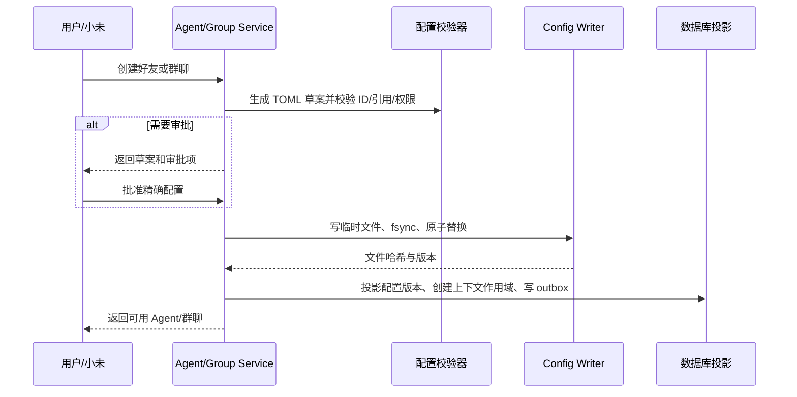

# FutureWork 工程目录设计

状态：设计稿。当前设计分支只有静态页面原型和文档；下文的包结构、用户目录、Runtime 和适配器均为目标架构，尚未在此分支实现。此前的实验性实现保留在 `feat/user-home-package` 分支，供以后决定开发时参考。

## 1. 核心原则

1. **配置文件定义身份，数据库保存运行状态。** 规划使用 `~/.futurework/agents/<id>.toml` 和 `~/.futurework/teams/<id>.toml` 作为 Agent 与群聊定义的来源。消息、任务、审批、未读数存入数据库；摘要与记忆按独立作用域存储。
2. **一个 ID 对应一个配置文件。** 文件名、文件内 `id` 和数据库投影 ID 必须相同。Agent 与群聊各用自己的命名空间；不要用展示名称、数组下标或文件路径作为运行时主键。
3. **上下文按作用域隔离。** 小未对话使用 `(workspace_id, assistant, assistant_id)`；Agent 私聊使用 `(workspace_id, agent, agent_id)`；群聊使用 `(workspace_id, group, group_id)`；任务使用短期作用域 `(workspace_id, task, task_id)`。
4. **群成员共享群上下文，不共享私聊上下文。** Agent 在群聊中可用自身角色配置和该群的历史、摘要及共享记忆；不得自动读取自己与用户的私聊，也不得读取其他群的历史。
5. **版本固定。** 配置变更产生新版本；已启动任务记录 Agent/群聊配置版本与上下文快照游标，避免执行中权限和规则悄然变化。
6. **用户创建也是创建配置。** 小未或用户在页面创建 Agent/群聊时，服务端先验证并写入对应 TOML，再同步数据库投影；高风险权限仍先走审批。

## 2. 安装方式与目录布局

### 2.1 安装和首次启动契约

未来工程以 Python 包发布，在项目根目录执行 `python -m pip install -e .` 后，应能从任意工作目录使用 `futurework` 命令或 `python -m futurework`。`pyproject.toml` 声明包发现、静态页面与内置默认配置的 package data、依赖及 `futurework` 命令入口；项目运行时不得依赖当前工作目录或源码树中的相对路径。

`pip install -e .` 负责安装包和命令入口。**首次执行 `futurework init` 或 `futurework serve` 时自动创建 `~/.futurework/`**；`serve` 内部先执行幂等初始化，再加载配置。这样普通安装、可编辑安装和升级都遵循相同规则，安装器不会在构建阶段改写用户目录。`futurework init` 用于希望启动前先检查或手工编辑配置的用户；`futurework paths` 显示实际路径。用 `FUTUREWORK_HOME` 或 `--home` 指定另一目录时，初始化和读取都只作用于该目录。

首次初始化只复制缺失的内置示例，不覆盖用户已有 TOML、Skill、Workflow、MCP 或记忆。旧版本升级不自动重置用户配置；需要迁移时先备份、校验 schema，再原子写入。用户目录权限默认仅当前用户可读写。初始化失败时给出具体文件路径和原因，不允许带着半套配置启动。

### 2.2 用户目录：配置和运行数据的真实位置

```text
~/.futurework/
├── app.toml                         # 服务、默认策略、预算和路径
├── models.toml                      # 多平台实例与模型别名
├── agents/
│   ├── assistant.toml               # 小未
│   └── <agent_id>.toml              # 手工编写或应用生成的 Agent 好友配置
├── teams/
│   └── <team_id>.toml               # 手工编写或应用生成的群聊/Team 配置
├── prompts/                         # 被 Agent 配置显式引用的长提示词
├── skills/
│   └── <skill_id>/SKILL.md          # 用户人工安装的 Skill 及其资源
├── workflows/
│   └── <workflow_id>/workflow.toml  # 用户人工安装/编写的 Workflow
├── mcp/
│   └── <server_id>.toml             # 用户配置的 MCP 连接；不存明文密钥
├── memory/
│   ├── assistant/                   # 小未个人助理作用域
│   ├── agents/<agent_id>/           # 每位好友的私聊记忆
│   └── teams/<team_id>/             # 每个群聊的共享记忆
├── data/                            # SQLite、任务产物、运行状态
├── logs/                            # 脱敏日志
└── cache/                           # 可重建缓存
```

用户可以直接编辑 `agents/*.toml`、`teams/*.toml`，并手工安装 Skill、Workflow 和 MCP 配置。加载器以文件名和内部 ID 一致为基本条件，扫描用户目录，按 `app → models/扩展注册表 → Agent → Team → Runtime` 的顺序解析与交叉校验；Team 引用的 Agent、Agent 引用的模型和扩展必须存在且可用。有效配置投影到数据库，消息、审批、任务和已读状态继续留在数据库；数据库中的旧投影不能覆盖手写 TOML。目录中存在无效配置时，保留上一个有效版本并明确报告错误，不静默跳过或使用内置示例代替。运行开始时固定配置版本；手工改文件后通过重启或显式 reload 使新配置进入后续运行，进行中的运行不换版本。

`skills/`、`workflows/`、`mcp/` 属于用户安装区域；应用随包发布的内置扩展只读，二者由同一个扩展注册表索引。发现一个扩展不等于启用或授权。`memory/` 与数据库中的消息/摘要共同组成上下文材料，但读写必须经过 `ScopeKey` 和权限策略，不能仅凭磁盘路径把某个 Agent 私聊记忆加载进群聊。密钥值由环境变量或系统密钥库提供，TOML 只保留引用。

### 2.3 目标源码模块树（逻辑视图）

```text
FutureWork/
├── README.md
├── pyproject.toml
├── uv.lock
├── .env.example                     # 环境变量名称示例；密钥不入库
├── config/
│   ├── app.toml                     # 服务、数据库、队列、限额、前端公开参数
│   ├── models.toml                  # 模型别名、供应商实例、费用/上下文窗口
│   ├── tools.toml                   # 工具注册表、风险等级、默认审批策略
│   ├── matching.toml                # 匹配权重、阈值、负载与成本参数
│   ├── planner.toml                 # 任务拆解约束、能力词典、回退规则
│   ├── runtime.toml                 # 单次运行的循环、超时、并发、重试与预算上限
│   ├── context.toml                 # 全局上下文预算、摘要、检索和保留策略
│   ├── extensions.toml              # 扩展来源、安装目录、信任策略和资源限额
│   ├── agents/
│   │   ├── assistant.toml           # 小未；特殊 Agent，仍遵循同一配置 schema
│   │   ├── research.toml            # 知知
│   │   ├── design.toml              # 小绘
│   │   ├── code.toml                # 阿码
│   │   ├── write.toml               # 言言
│   │   └── plan.toml                # 程程
│   ├── teams/
│   │   ├── launch.toml              # 产品发布小组
│   │   ├── weekly.toml              # 每周进展同步
│   │   └── ideas.toml               # 灵感碰撞室
│   └── prompts/
│       ├── assistant.md
│       └── agents/                  # 可选长提示词；由 Agent TOML 显式引用
├── extensions/
│   ├── builtin/                    # 随应用版本发布；代码审查后入库
│   │   ├── tools/
│   │   │   ├── calculator/
│   │   │   │   ├── manifest.toml    # ID、版本、参数 schema、风险和入口
│   │   │   │   └── handler.py       # Python 工具实现
│   │   │   └── web_search/          # 受控搜索接口；凭证来自密钥管理层
│   │   ├── skills/
│   │   │   └── research-brief/
│   │   │       ├── manifest.toml    # 依赖、适用 Runtime、输入和资源声明
│   │   │       ├── SKILL.md         # Agent 使用说明
│   │   │       └── resources/       # 可选模板与静态资料
│   │   ├── mcp/
│   │   │   └── example-server/
│   │   │       └── manifest.toml    # MCP 连接/启动定义，不含凭证
│   │   └── workflows/
│   │       └── product-launch/
│   │           └── workflow.toml   # 声明式步骤、依赖和审批点
│   └── schemas/                    # 扩展包 manifest、工具输入、workflow schema
├── backend/
│   ├── __main__.py                  # 从 app.toml 读取监听配置并启动
│   ├── bootstrap.py                 # 加载、校验全部配置并建立数据库投影
│   ├── api/
│   │   ├── app.py                   # FastAPI 组装，不放业务规则
│   │   ├── agents.py                # Agent 查询、创建、配置修订
│   │   ├── groups.py                # 群聊查询、创建、成员变更
│   │   ├── conversations.py         # 消息、已读、会话查询
│   │   ├── tasks.py                 # 任务与步骤
│   │   ├── approvals.py             # 精确动作/配置审批
│   │   └── events.py                # SSE 及断线重放
│   ├── schemas/
│   │   ├── agent_config.py          # Pydantic：Agent TOML schema
│   │   ├── group_config.py          # Pydantic：Group TOML schema
│   │   ├── runtime.py               # 消息、任务、审批 API schema
│   │   └── config_validation.py     # 引用完整性、唯一性、路径安全
│   ├── config_store/
│   │   ├── loader.py                # 扫描 TOML、解析、哈希、版本
│   │   ├── writer.py                # 草稿、原子写入、冲突检查
│   │   └── reconciler.py            # 文件与数据库投影对账
│   ├── domain/
│   │   ├── agents.py                # Agent 身份、版本、状态机
│   │   ├── groups.py                # 成员关系、群回复策略
│   │   ├── tasks.py                 # 任务和 DAG 状态机
│   │   ├── permissions.py           # 工具和数据作用域判定
│   │   └── matching.py              # 纯 Python 能力匹配算法
│   ├── contexts/
│   │   ├── types.py                 # ScopeKey、ContextSnapshot、引用元数据
│   │   ├── assistant_context.py     # 小未对话、计划摘要与任务追踪
│   │   ├── agent_context.py         # Agent 私聊历史与私有记忆
│   │   ├── group_context.py         # 群消息、群摘要与共享记忆
│   │   ├── task_context.py          # 单次任务的临时输入和产物
│   │   ├── assembler.py             # 按权限组装模型上下文
│   │   ├── summarizer.py            # 增量摘要、回溯来源
│   │   ├── retrieval.py             # 按作用域检索；不得跨域默认搜索
│   │   └── policy.py                # 显式分享、保留与删除规则
│   ├── runtime/
│   │   ├── router.py                # 按会话类型选择三种顶层 Runtime
│   │   ├── assistant_runtime.py     # 小未对话：规划、分派、建 Agent、汇总
│   │   ├── direct_runtime.py        # Agent 私聊：单 Agent 回复与私有上下文
│   │   ├── group_runtime.py         # 群聊公共状态机与共享上下文
│   │   ├── group_swarm.py           # 无中控：成员自治、发言队列与停止条件
│   │   ├── group_controlled.py      # 小未中控：规划、分派、跟踪与汇总
│   │   ├── agent_executor.py        # 三种 Runtime 共用的单 Agent 推理/工具循环
│   │   ├── run_spec.py              # 配置版本、上下文作用域、任务和预算快照
│   │   ├── checkpoints.py           # 运行状态持久化、恢复和取消
│   │   └── tool_dispatch.py         # 工具授权、审批与调用入口
│   ├── extension_system/
│   │   ├── registry.py              # 内置与已安装扩展的统一索引、版本固定
│   │   ├── installer.py             # 下载/导入、校验、暂存、原子安装与回滚
│   │   ├── resolver.py              # 为一次 Runtime 运行解析允许的扩展快照
│   │   ├── skill_loader.py          # 加载 SKILL.md 与资源，不隐式执行代码
│   │   ├── mcp_client.py            # MCP 发现、连接、schema 与超时控制
│   │   └── workflow_runner.py       # 校验并调度声明式工作流 DAG
│   ├── services/
│   │   ├── agent_service.py          # 创建配置、审批、激活、版本切换
│   │   ├── group_service.py          # 创建群、成员变更、上下文初始化
│   │   ├── message_service.py        # 消息写入、路由、事件
│   │   ├── task_service.py           # 规划、分派、执行、汇总
│   │   └── inbox_service.py          # 最近动态/全部/待审批读模型
│   ├── integrations/
│   │   └── model_gateway/
│   │       ├── gateway.py           # 别名路由、预算、重试、用量归一化
│   │       ├── types.py             # ModelRequest/ModelResult/错误类型
│   │       ├── registry.py          # 加载平台实例和模型别名
│   │       └── adapters/
│   │           ├── openai_chat.py   # OpenAI Chat Completions 协议
│   │           ├── anthropic.py     # Claude Messages 协议
│   │           ├── base.py          # Adapter 协议与能力声明
│   │           └── profiles/        # 平台差异：阿里云、DeepSeek、Kimi、MiniMax、OpenRouter、OpenAI
│   ├── persistence/
│   │   ├── models.py                # SQLAlchemy 表
│   │   ├── repositories/            # Agent、Group、Context、Task 等仓储
│   │   └── unit_of_work.py          # 事务与 outbox
│   └── workers/
│       ├── task_worker.py           # 长任务、租约、重试
│       └── config_reconciler.py     # 配置文件与投影周期核对
├── frontend/
│   ├── index.html
│   ├── src/
│   │   ├── app/                    # 路由、初始化、SSE 客户端
│   │   ├── features/
│   │   │   ├── agents/              # 好友列表与配置抽屉
│   │   │   ├── groups/              # 群聊列表、成员管理
│   │   │   ├── chat/                # 聊天区和消息卡
│   │   │   ├── inbox/               # 最近/全部/待审批视图
│   │   │   └── tasks/               # 任务 DAG 与状态
│   │   └── shared/                 # API client、类型、通用组件
│   └── public/
├── migrations/                     # 数据库结构迁移
├── tests/
│   ├── config/                     # 文件 schema、引用和热更新测试
│   ├── contexts/                   # 私聊/群聊隔离测试
│   ├── domain/                     # 匹配、DAG、权限纯函数测试
│   ├── extensions/                 # 安装、依赖、授权、版本与沙箱测试
│   ├── api/                        # 契约与幂等测试
│   └── e2e/                        # 页面主流程
├── scripts/                        # 开发启动、导入、备份和配置检查
├── docs/                           # 架构、接口、运维与迁移方案
└── data/                           # 本地运行数据；gitignored
    └── extensions/                 # 运行时安装的扩展；生产环境改为持久卷/对象存储
        ├── skills/<publisher>/<id>/<version>/
        ├── mcp/<publisher>/<id>/<version>/
        ├── workflows/<publisher>/<id>/<version>/
        └── tools/<publisher>/<id>/<version>/
```

这是**目标模块组织方式**。未来 Python 代码放在可安装包 `src/futurework/`；上面的 `backend/` 和 `frontend/` 表达后端模块与页面资源的职责，不要求按这棵概念树在仓库根目录创建同名文件夹。`config/` 和 `data/extensions/` 所指的可写内容规划放在 `~/.futurework/`：`app.toml`、`models.toml`、`agents/`、`teams/`、`skills/`、`mcp/`、`workflows/`、`memory/`、`data/`。内置默认文件随包发布，首次运行复制到用户目录；以后以用户目录为准。当前分支的静态页面原型位于 `frontend/`。

## 3. 配置文件契约

### 3.1 Agent：一个文件定义一个好友

`~/.futurework/agents/research.toml` 目标配置示例：

```toml
schema_version = 1
id = "research"
name = "知知"
role = "研究与洞察"
kind = "friend"
status = "active"
icon = "知"
color = "#e7e8fa"
ink = "#7873ad"
prompt_file = "prompts/agents/research.md"

[model]
id = "default_fast"                 # 引用 models.toml 中的别名
temperature = 0.4                   # 覆盖全局默认值；可省略

[capabilities]
"research.web" = 0.95
"analysis.summary" = 0.80

[permissions]
tools = ["builtin/web_search@1.0.0"]
approval_policy = "standard"       # 引用 tools.toml 中的策略
data_scopes = ["user_shared_files"]

[extensions]
skills = ["builtin/research-brief@1.0.0"]
mcp_servers = []
workflows = []

[context]
private_memory = true
history_token_budget = 6000
summary_trigger_tokens = 4500
memory_retention_days = 180
share_to_groups = "explicit_only"

[limits]
max_concurrent_tasks = 2
daily_token_budget = 100000

[runtime]
profile = "standard"                 # 引用 runtime.toml；小未可用 orchestrator
max_turns = 8                         # 只能在全局硬上限内覆盖
```

`assistant.toml` 使用相同 schema，增加 `kind = "assistant"`、`system = true` 和规划权限；系统内恰好一个 assistant。`prompt_file` 的相对路径只能落在 `~/.futurework/prompts/` 内。小型 Agent 可直接用 TOML 的 `system_prompt` 字段；长提示词用独立 Markdown 文件，仍由该 Agent 配置文件引用。

### 3.2 Group：一个文件定义一个群聊

`~/.futurework/teams/launch.toml` 中控群示例：

```toml
schema_version = 1
id = "launch"
name = "产品发布小组"
status = "active"
icon = "发"
color = "#e4ede7"
ink = "#398769"
members = ["design", "write", "plan"]
mode = "controlled"                 # controlled | swarm

[reply]
max_responders_per_round = 3
max_rounds = 2
max_total_model_calls = 8
on_budget_exhausted = "summarize_and_stop"

[controller]
agent_id = "assistant"              # controlled 必须为小未；swarm 禁止设置
selection_policy = "mention_then_capability"
require_plan = true
summarize_results = true

[context]
history_token_budget = 10000
summary_trigger_tokens = 7500
shared_memory = true
memory_retention_days = 180
private_chat_import = "never"
history_visibility = "since_joined"

[permissions]
allow_member_tools = true             # 不授予新权限；仍以各 Agent 的授权为上限
external_share = "approval_required"

[extensions]
skills = []                            # 群共享操作说明，不扩大成员工具权限
workflows = ["builtin/product-launch@1.0.0"]
mcp_allowlist = []                     # 群可用连接上限；成员仍须独立授权
```

`swarm` 群保留共同字段和 `[reply]`，删除整个 `[controller]` 表。群配置只引用成员 ID，不复制成员的模型、能力或工具授权。成员不存在、处于 archived 状态或重复时，启动校验失败。`mode` 只允许 `swarm`、`controlled`；`controlled` 必须指定小未，`swarm` 不得出现中控配置。群聊的 `allow_member_tools` 仅表示群内是否允许发起工具请求，不能覆盖 Agent 自身权限和用户对资源的授权。模式、成员或预算变化产生新的群配置版本，进行中的一轮继续使用启动时的快照。

**Swarm：无中控。** 每个 Agent 根据自身能力、群内消息和显式 `@` 判断是否参与；`@` 限定候选成员，无 `@` 时所有符合群订阅规则的成员可提出发言意向。`GroupChatRuntime` 只负责公平排队、并发限制、消息提交顺序、预算和停止条件，不生成任务计划，也不以小未身份决定谁该说什么。成员能看到群作用域内已提交的消息，不能读取其他成员的私聊。每轮每个成员最多一次主动发言；后续轮次只由新群消息或明确协作请求触发。所有成员间的请求和结果都写入群时间线，防止隐形对话和无限循环。

**Controlled：小未中控。** 小未在群作用域中创建结构化 `GroupPlan`（用户目标、候选成员、分派步骤、依赖、预算、停止条件），策略校验后再分派。明确 `@Agent` 是候选约束；小未可以请求补充信息、安排多名成员按步骤协作、汇总结果或发起审批。她只使用本群上下文和成员公开能力，不自动读取自己与用户的私聊记忆，也不把群聊内容写回个人助理私聊。若小未模型不可用，采用配置的降级策略：暂停并告知用户，或按显式规则选择一位成员；不能静默切到 Swarm。两种模式均受同一群权限和成本硬上限约束。

### 3.3 全局配置与覆盖顺序

`app.toml` 只放全局运行参数；模型、工具、匹配、上下文各有专用文件。**生效值 = 全局默认值 → 作用域配置覆盖 → 任务级限制收紧**。任务只能收紧限额或权限，不得扩大 Agent/群权限。敏感配置（模型 API key、数据库凭证）由环境变量或密钥管理器注入；TOML 只存环境变量名称/密钥引用。

文件解析使用 `tomllib`，Pydantic schema 设置 `extra = "forbid"`，避免拼写错误被静默忽略。校验必须覆盖：schema 版本、文件名与 ID 一致、ID 唯一、模型/工具/能力引用有效、成员关系有效、上下文预算为正、风险策略不弱于全局下限、提示词路径不能越界。配置通过校验后计算内容哈希并存入 `config_versions`；热更新只对新任务生效。

#### 3.3.1 多平台模型注册与适配器

`~/.futurework/models.toml` 将**平台实例**与**模型别名**分开。平台实例决定协议、接口地址和密钥环境变量；别名决定平台实例、原生模型 ID、能力、上下文窗口和预算参数。Agent 的 `[model].id` 只引用别名，不直接写 URL 或密钥。用户可以同时配置多个平台，甚至为同一供应商配置两个不同账户。示例：

```toml
schema_version = 1

[providers.aliyun_cn]
adapter = "openai_chat"
base_url = "https://dashscope.aliyuncs.com/compatible-mode/v1"
api_key_env = "DASHSCOPE_API_KEY"
region = "cn"

[providers.deepseek]
adapter = "openai_chat"
base_url = "https://api.deepseek.com"
api_key_env = "DEEPSEEK_API_KEY"

[providers.claude]
adapter = "anthropic_messages"
base_url = "https://api.anthropic.com"
api_key_env = "ANTHROPIC_API_KEY"
api_version = "2023-06-01"

[models.default_fast]
provider = "deepseek"
remote_id = "deepseek-chat"
context_window = 64000
supports_tools = true
supports_streaming = true
# 价格未知时省略价格字段，此模型不可用于自动成本比较或自动跨平台回退

[models.review_strong]
provider = "claude"
remote_id = "<填入账户可用的 Claude 模型 ID>"
context_window = 200000
supports_tools = true
supports_streaming = true
```

平台实例可用多个别名复用。`model_id` 与 `remote_id` 不应混用：本项目用 `models.<alias>` 作为稳定引用，`remote_id` 原样传给平台。实际端点、模型 ID、价格、上下文限制与功能支持均由用户按账户和平台文档配置并校验；示例不承诺特定模型长期可用。

| 平台实例类型 | 目标适配器 | 关键差异 |
| --- | --- | --- |
| OpenAI GPT | `openai_chat.py` | Bearer key、Chat Completions 消息和工具调用 |
| 阿里云百炼、DeepSeek、Kimi、MiniMax | `openai_chat.py` + 各自的 profile；确有协议差异时增加平台适配器 | 优先用官方兼容端点；按平台分别校验端点、模型 ID、参数、鉴权、错误和 usage，不在业务层写平台分支 |
| OpenRouter 等第三方聚合平台 | `openai_chat.py` + 平台元数据 | 远端模型 ID 可能含供应商前缀；上游实际供应商、地域及价格需要记录，敏感数据路由受策略限制 |
| Anthropic Claude | `anthropic.py` | Messages API、`x-api-key`/版本头、独立 system 与 content block；工具结果和停止原因单独映射 |

`ModelGateway.generate(ModelRequest) -> ModelResult` 是唯一模型入口。请求包括别名、消息与内容块、工具 schema、流式开关、作用域、截止时间和 token/费用预算；结果统一文本、工具调用、usage、结束原因、平台 request ID 与错误类别。适配器只做协议转换、鉴权头与响应解析；网关负责路由、并发/速率限制、审计、用量与费用核算。模型参数先取全局默认，再应用平台限制和 Agent 覆盖；调用前检查 `supports_tools`、`supports_streaming`、上下文窗口及预算，不能把不支持的能力硬塞进请求。

每个平台 profile 独立声明 `endpoint_path`、默认请求头、支持的参数、工具/流式能力映射、错误码与 usage 解析规则：`openai`、`aliyun`、`deepseek`、`kimi`、`minimax`、`openrouter`；Claude 使用 `anthropic` 协议适配器和 profile。这样多平台共用协议核心，但兼容性差异有明确维护位置。未知 OpenAI 兼容平台可从受限的 `openai_chat` profile 起步，只有通过契约测试后才开放工具调用、流式输出或自动回退。平台返回的模型列表可供配置检查，但不能自动改写 Agent 已选的别名。

密钥只保存在环境变量或系统密钥库，配置文件只写引用；日志、异常和 SSE 事件必须脱敏。401/403、配置错误和能力不支持直接失败；429、5xx、超时按平台 `Retry-After` 和指数退避重试，次数与总耗时受全局硬上限约束。产生工具副作用后禁止自动重放整轮请求。跨平台回退必须由 Agent 显式列出候选别名，并逐一验证工具能力、数据地域、费用与用户授权；不能因为一个平台故障就把私有数据自动发到另一个平台。上述网关和适配器均为设计目标。

### 3.4 三种对话 Runtime

三类对话需要**三个不同的顶层 Runtime**。`runtime/router.py` 根据会话类型选择其一；它们各自决定上下文、状态流转和可执行动作，共用底层的 `AgentExecutor`、模型网关、工具检查和 checkpoint 组件。这里的 Runtime 是一次会话处理的执行器，不要求为每个好友或群聊常驻一个 Python 进程。

| Runtime | 负责的会话 | 上下文作用域 | 核心职责 |
| --- | --- | --- | --- |
| `AssistantRuntime` | 用户 ↔ 小未 | `(workspace_id, "assistant", "assistant")` | 理解目标、规划、分派、创建 Agent 配置草案、跟踪和汇总任务 |
| `DirectChatRuntime` | 用户 ↔ 某个 Agent 好友 | `(workspace_id, "agent", agent_id)` | 加载该 Agent 配置和私聊上下文，完成单 Agent 回复与获准的工具调用 |
| `GroupChatRuntime` | 用户与多个 Agent 的群聊 | `(workspace_id, "group", group_id)` | 固定群配置版本和上下文，按 `mode` 调用 Swarm 或 Controlled 策略，控制轮次、预算与消息提交 |

```text
用户消息
  -> MessageRouter 读取会话类型与配置版本
     -> assistant_direct: AssistantRuntime.run(assistant_scope)
     -> agent_direct:   DirectChatRuntime.run(agent_scope)
     -> group:          GroupChatRuntime.run(group_scope, mode)
                         -> swarm: SwarmPolicy -> AgentExecutor(member...) * N
                         -> controlled: XiaoWeiController -> GroupPlan -> AgentExecutor(member...) * N

三种 Runtime 调用共用的 AgentExecutor：
  AgentExecutor.run(agent_config_version, allowed_context, task, budget)
    -> ModelGateway -> ToolDispatch -> Checkpoint
```

**AssistantRuntime** 可以创建任务计划和子任务，但只从自己的上下文及经授权回传的任务产物中取材。它不能因“协调者”身份直接读取任意好友私聊或绕过权限审批。**DirectChatRuntime** 固定一个好友配置版本及其私有上下文，聊天内容不会写入群共享记忆。**GroupChatRuntime** 拥有独立群状态机和上下文管理：`SwarmPolicy` 只执行成员自治发言和调度约束，`ControlledPolicy` 调用小未的群内中控子执行生成结构化计划，再把步骤交给成员的 `AgentExecutor`。两者都只传入群上下文及当前任务授权材料，不带入成员私聊。中控执行不等于 `AssistantRuntime` 的个人助理会话；它复用小未的身份配置和执行器，但使用群 `ScopeKey`、群预算、群审计记录。

群运行状态为 `received → selecting/planning → dispatching → collecting → summarizing/completed`，任一步可进入 `waiting_approval`、`failed` 或 `cancelled`。Swarm 跳过 `planning`，不生成中控总结；Controlled 可由小未生成汇总。成员结果提交到群时间线后才可作为下一轮输入。`max_rounds`、`max_responders_per_round`、`max_total_model_calls` 和 token/费用上限共同截断循环；达到上限时明确告知用户已有产物与未完成项。

三个 Runtime 的顶层状态分别持久化为 `runtime_runs` 记录，含 `run_id`、`runtime_type`、群 `mode`、`scope_key`、配置版本、消息游标、状态、预算和 checkpoint。群内小未的中控计划及每位成员的单次执行分别有 `group_plans`、`agent_executions` 子记录，关联群 `run_id`，以便取消、重试和审计。任务 worker 调用 `AgentExecutor` 完成子任务；它属于任务执行路径，不混用私聊或群聊的顶层状态机。

`runtime.toml` 统一定义最大循环次数、超时、重试、并发、token/费用硬上限和 checkpoint 周期；Agent TOML、群 TOML 只能在硬上限内收紧。`RunSpec` 固定 `agent_config_version?`、`group_config_version?`、`scope_key`、`context_cursor`、`task_id?` 和权限快照。权限变化只影响新运行；已暂停运行恢复时仍需重新检查敏感工具授权和审批有效期。

**当前设计分支：** 群聊只有静态交互演示。多平台网关、两种群模式、三个独立 Runtime、群成员子执行记录和可恢复 checkpoint 均为后续开发目标。

### 3.5 Tool、Skill、MCP 与 Workflow 扩展目录

`extensions/builtin/` 放随应用发布且经过代码审查的内置扩展；`data/extensions/` 放用户后续安装的版本化扩展（本地开发路径，生产应为独立持久卷或扩展仓库）。两者由 `extension_system/registry.py` 统一索引，但**安装、启用、授予 Agent/群使用权**是三个独立动作。安装成功不等于自动进入任意 Agent 的上下文或获得工具权限。

| 类型 | 目录内容 | 谁调用 / 关键边界 |
| --- | --- | --- |
| Tool | `manifest.toml` + Python handler、输入/输出 schema、风险等级 | `AgentExecutor` 经 `ToolDispatch` 调用；实际权限由 Agent 配置、资源作用域和审批共同决定 |
| Skill | `manifest.toml` + `SKILL.md` + 可选静态资源 | 在适用 Runtime 中按需加载为方法说明；Skill 文本本身不能授予工具、MCP 或文件访问权 |
| MCP | 服务器连接/启动 manifest、可发现工具 schema、超时与资源限制 | `mcp_client.py` 建立连接；每个 MCP 工具仍进入统一 ToolDispatch 授权与审计链 |
| Workflow | `workflow.toml` + 可选模板、步骤 schema | `workflow_runner.py` 校验 DAG 后调度；步骤指向 Agent/能力/工具/审批点，不能直接绕过 Runtime |

扩展引用统一采用 `publisher/id@version`，类型由配置字段区分，例如 `skills = ["builtin/research-brief@1.0.0"]`。运行开始时将解析结果及内容哈希固定在 `RunSpec`；任务执行中升级扩展不改变该次运行。配置引用不存在、版本不兼容、依赖缺失或风险策略被降低时，配置发布失败。

**安装流程：** 从批准的来源获取包 → 暂存目录 → 校验 manifest/schema、内容哈希、版本与依赖 → 列出所需权限和可执行代码 → 用户审批高风险扩展 → 原子安装到 `data/extensions/<type>/<publisher>/<id>/<version>/` → 登记版本 → 由用户显式启用并分配到 Agent/群配置。更新安装新版本，不覆盖旧版本；支持回滚和停用。外部包默认不自动更新。

`config/extensions.toml` 集中管理允许的来源、安装根目录、签名/哈希要求、最大包大小、MCP 连接超时、子进程 CPU/内存/网络限制、默认禁用策略和更新策略。MCP 凭证只存密钥管理层，manifest 存环境变量名或凭证引用。来自第三方的 Python Tool 或本地 MCP 进程必须在隔离环境执行；未经审查的 Skill 附带脚本不能因为读取 `SKILL.md` 就运行。

**三种 Runtime 的用法：** `AssistantRuntime` 可提议安装 Skill/MCP/Workflow，并按获准配置调用规划类 Skill 和 Workflow；`DirectChatRuntime` 只解析该好友配置中启用的扩展；`GroupChatRuntime` 解析群级 Workflow/共享 Skill，再按成员各自权限解析 Tool/MCP。群配置的允许列表是上限，不会把某成员缺少的权限补给他。Workflow 步骤通过三种 Runtime 或任务 worker 调用 `AgentExecutor`，所有外部副作用均需对应审批。

第一批内置扩展建议保持小而可验证：Tool 提供计算器与受控网页搜索；Skill 提供任务拆解、研究简报、文案审校；Workflow 提供每周进展汇总和产品发布准备；MCP 先提供连接模板与客户端适配，实际外部服务器由用户连接后启用。每个内置包仍有独立 manifest、版本和测试，不把全部实现塞进一个 `tools.py`。

Workflow 使用声明式 DAG，例如：

```toml
schema_version = 1
id = "product-launch"
version = "1.0.0"
entry = "research"

[[steps]]
id = "research"
kind = "agent_task"
capability = "research.web"
depends_on = []

[[steps]]
id = "design"
kind = "agent_task"
capability = "design.visual"
depends_on = ["research"]

[[steps]]
id = "review"
kind = "approval"
depends_on = ["design"]
```

加载器校验无环、步骤数与成本上限、能力/扩展引用和审批点；`approval` 步骤只能等待用户决定，不能由 Skill 文本或模型输出自动标记为通过。

## 4. 独立上下文模型

### 4.1 四种作用域

| 作用域 | 唯一键 | 内容 | 可读取者 |
| --- | --- | --- | --- |
| 小未对话 | `(workspace_id, "assistant", "assistant")` | 用户与小未的对话、计划摘要和待跟踪任务 | 用户、小未；其他 Agent 只能接收明确分派的任务材料 |
| Agent 私聊 | `(workspace_id, "agent", agent_id)` | 用户与该 Agent 的私聊消息、私有摘要、私有记忆 | 用户、该 Agent、经明确授权的小未任务 |
| 群聊 | `(workspace_id, "group", group_id)` | 群消息、群摘要、群共享记忆、群任务关联 | 用户、当前成员 Agent；离群成员不再获得新上下文 |
| 任务 | `(workspace_id, "task", task_id)` | 本任务输入、步骤产物、引用和审批快照 | 被分派的 Agent 仅可读取自己的步骤及明确共享的产物 |

小未对话、私聊、群聊、任务共用底层存储接口 `ContextStore`，但分别由 `AssistantContextService`、`AgentContextService`、`GroupContextService`、`TaskContextService` 处理。所有存取方法必须接收类型化 `ScopeKey`；禁止只用裸 `conversation_id` 查询。数据库为每条消息/摘要/记忆加 `workspace_id`、`scope_type`、`scope_id`，并建联合索引。仓储查询总是同时按三者过滤；应用层再检查成员和授权。

**建议表：** `context_messages`、`context_summaries`、`context_memories`、`context_shares`。消息表保存发送者、所属作用域、源消息 ID、可见性；摘要表保存覆盖的消息游标和版本；记忆表保存来源、有效期、删除标记；分享表保存来源/目标作用域、分享人、目的、过期时间与撤销状态。审批、任务和配置版本各有独立表，不与上下文混为一个 JSON 字段。

### 4.2 模型上下文组装

```text
与小未对话：
  assistant.toml 配置版本 + 小未对话最近消息 + 计划摘要/任务追踪 + 获准分享的产物

与 Agent 私聊：
  Agent 配置版本 + 私聊最近消息 + 该 Agent 私有摘要/记忆 + 当前任务授权材料

在群里 @Agent：
  Agent 配置版本 + 当前群最近消息 + 该群摘要/共享记忆 + 当前群任务材料
  （不加载 Agent 私聊历史和其他群历史）

小未分派跨会话任务：
  小未自身上下文 + 用户当前任务 + 经授权分享的产物摘要
  （不复制原始私聊全文到其他 Agent 或群）
```

`assembler.py` 先调用 `policy.py` 判定可见来源，再按预算组装；`retrieval.py` 的查询必须带作用域过滤。优先保留当前用户指令、审批约束和未完成步骤；旧消息由 `summarizer.py` 增量压缩，摘要保留源消息 ID 和版本，以便追溯。摘要不能改变消息的可见范围。引用私聊内容到群聊时，用户通过明确的“分享到群聊”动作生成 `context_shares`，只分享指定消息/产物，支持撤销与过期。

### 4.3 群成员变更与生命周期

- **加入群**：新成员默认可读取加入后的群消息。是否可读取加入前历史由群配置 `history_visibility` 决定；建议默认 `since_joined`，如需历史回放须由用户授权。
- **退出群**：停止获取新消息和新摘要；已生成的任务步骤仍按启动时的成员与配置快照执行或由用户取消重分派。
- **群归档**：群配置状态变为 archived，禁止新消息/任务；历史按保留策略只读保存。
- **Agent 归档**：不删除私聊记录；群配置中的该成员引用需先移除或替换，校验器阻止悬空引用。
- **删除/导出**：按作用域导出或删除消息、摘要、记忆和索引，异步清理派生缓存；保留必要审计记录但不能保留可恢复的被删除正文。

## 5. 配置变更和动态创建

### 5.1 创建流程



文件是权威来源，数据库是可查询的投影。**不能在生产多实例里让每个 API Pod 写自己的本地目录。** 本地版可直接原子写入 `~/.futurework/agents/` 或 `~/.futurework/teams/`；生产版使用独立的可写配置仓库/配置服务，验证后提交版本，再由各实例同步。若文件写入成功而数据库事务失败，`reconciler.py` 根据文件哈希重建投影；若数据库中有未对应文件的临时草案，不将其视为 active。配置写入必须有文件锁/版本条件，避免并发覆盖。

### 5.2 编辑与审批

页面编辑 Agent 或群聊时提交 `expected_config_version`。服务端比较差异：模型/能力/成员/上下文策略/工具授权等是否扩大访问范围。低风险更新写新文件版本；高风险更新先存草案和审批，批准后才发布新文件版本。**不能在批准前直接修改 active 配置。** 任务步骤记录 `agent_config_version`、`group_config_version?` 和 `context_cursor`；执行过程中仅使用该快照。

## 6. 未来实现顺序

1. **建立逐文件配置。** 定义 `~/.futurework/agents/`、`~/.futurework/teams/`、`models.toml` 的 schema、内容哈希、版本冲突检查、加载与数据库投影；保留已有原型中的 Agent 和群名称。
2. **引入类型化上下文。** 消息和已读游标带 `scope_type`、`scope_id`、`workspace_id`，建立联合索引，所有查询改用 `ScopeKey`。检查无同名 ID 混淆和跨群读取。
3. **建立模型网关及三种 Runtime。** 按本文设计实现协议适配器、别名注册表、预算与错误映射；先验证 OpenAI 兼容平台及 Anthropic Messages，再按平台实际差异扩展。按会话类型实现 `AssistantRuntime`、`DirectChatRuntime`、`GroupChatRuntime`，共同复用 `AgentExecutor`。
4. **把群 Runtime 分成两种策略。** 先给 Team 配置增加 `mode` 与预算字段、数据库投影和版本固定，再实现 `SwarmPolicy` 的成员自治和 `ControlledPolicy` 的小未群内计划。页面应显示群模式并允许创建或编辑时选择；模式切换只影响新运行。
5. **实现配置写入闭环。** 手动创建、由小未创建、群聊创建及配置编辑都走同一个 writer + validator；高风险草案先审批。增加文件与投影对账、版本冲突和崩溃恢复测试。
6. **建立扩展注册与安装链。** 先实现内置 Tool/Skill/Workflow 的 manifest 校验和 Runtime 解析，再接 MCP 客户端；第三方安装须完成暂存、校验、权限审批、版本固定和隔离执行。
7. **最后替换运行基础设施。** 按 [系统设计](system-design.md) 引入 PostgreSQL、持久队列、用户鉴权和工具沙箱；上下文作用域与配置契约无需再改。

## 7. 必须通过的隔离测试

- 同一条用户消息按会话类型只进入对应 Runtime；小未对话、Agent 私聊和群聊分别写入自己的 `ScopeKey` 与 checkpoint。
- Agent A 私聊中出现的唯一标记，不得出现在 Agent B 私聊或任一群上下文的检索结果中。
- Agent A 加入群 X，不得因此读取自己私聊或群 Y 的摘要；群 X 新成员默认不得读取加入前历史。
- 小未把私聊产物分享至群 X 时，只能看到指定产物，撤销后检索结果中消失。
- 同时编辑同一 Agent 配置，旧 `expected_config_version` 必须返回冲突；旧审批不能激活新草案。
- 配置文件缺失、ID 与文件名不一致、群成员不存在、工具未注册、提示词路径越界，启动或发布必须失败且 active 版本保持不变。
- 安装 Skill 不得自动授予其声明的 Tool/MCP；未授权的 MCP 工具调用必须被 `ToolDispatch` 拒绝并写审计事件。
- 扩展升级后旧任务继续使用原版本；停用、回滚和依赖缺失不得让运行中的 Workflow 静默切换实现。
- 重启服务后从文件重建数据库投影，原有消息、审批和上下文摘要仍属于原作用域。
- 同一用户目录同时启用阿里云、DeepSeek、Kimi、MiniMax、OpenAI、OpenRouter 和 Claude 配置时，Agent 别名必须路由到正确平台与协议；密钥不得进入日志、配置回显或模型响应。Anthropic 的 system/content block 与 OpenAI 兼容消息、工具调用、usage、结束原因分别做契约测试。
- 模型别名不存在、平台失效、能力不支持、429/超时、预算耗尽和跨平台回退未授权时，应返回明确状态；不得自动把私有群消息发往未许可的平台。
- Swarm 群运行中不能产生小未中控计划；成员仅看到本群已提交消息，回应人数和轮次达上限后停止。Controlled 群由小未生成可审计计划，`@` 约束生效，小未不能读取个人助理私聊记忆；切换群模式后旧运行仍按原版本完成或取消。
