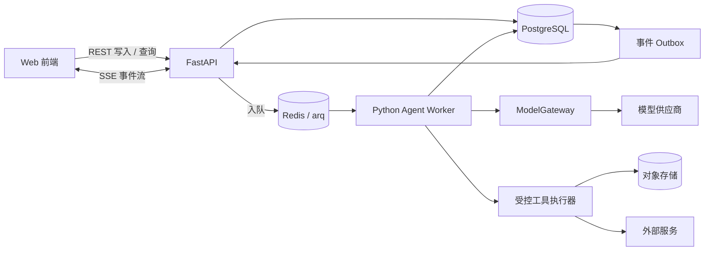
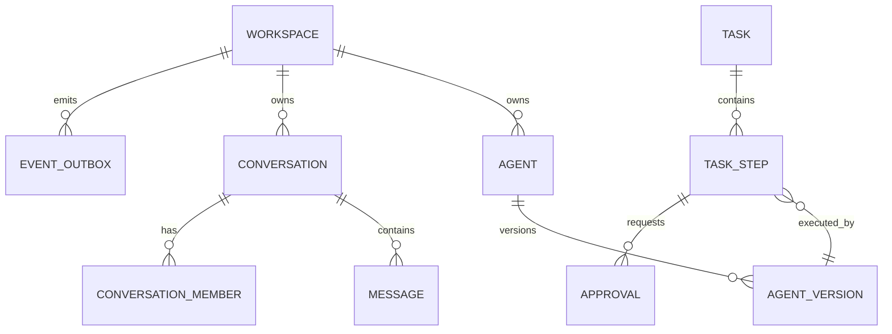
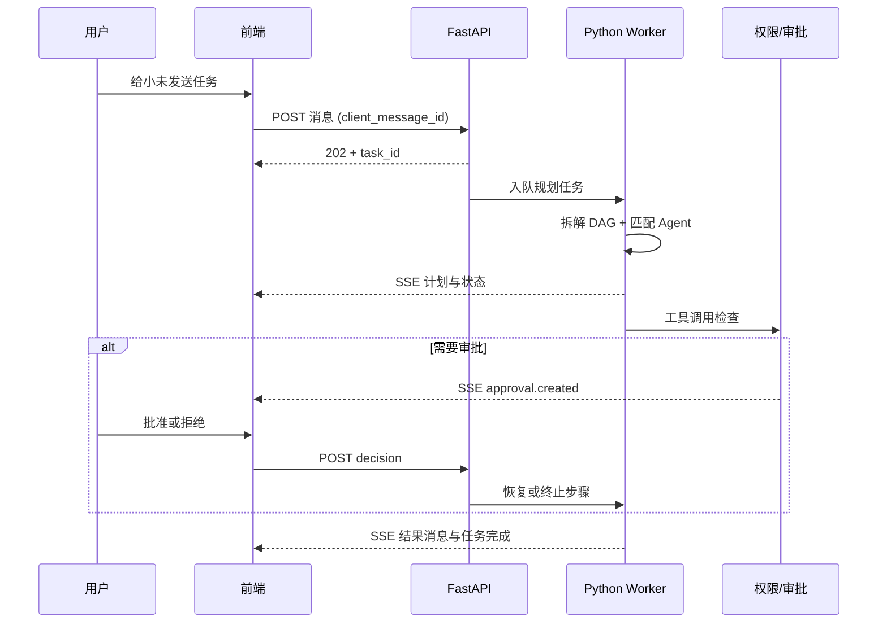

# FutureWork 系统设计（v1）

状态：目标架构。当前可运行 MVP 已实现本地聊天、持久化、规则分派、自动建 Agent、配置审批和 SSE；PostgreSQL、Redis worker、真实工具执行、完整鉴权及多用户隔离仍属后续阶段。具体已实现范围见根目录 README。

## 1. 目标、边界与设计决定

### 1.1 用户视角

- 用户只有一个「自己」账号。小未是固定的个人助理 Agent，负责接收自然语言任务、拆解、分配、汇报和创建缺失的 Agent。
- 左侧是 Agent 好友与协作群聊。Agent 好友是一对一对话；群聊是用户与多个 Agent 的共享对话。群内每条消息都明确标记发送者。
- 首页默认打开小未。右侧默认显示最近有活动的对话摘要；展开后显示全部 Agent 和群聊卡片；「待我审批」只显示存在未决审批的对话。
- 点击 Agent 好友可直接对话，并配置其模型、工具、能力和审批策略。点击群聊可查看共享消息与成员，但群聊本身不拥有独立的工具权限，工具调用仍归具体 Agent。
- 小未可以创建并配置新 Agent。创建低风险 Agent 可自动完成；涉及外部发送、代码执行、敏感数据或权限扩大时，先生成配置提案，等用户批准后才启用相应权限。

### 1.2 v1 范围

单用户、单工作空间、Web 桌面优先，兼容窄屏；文本消息、Agent 群聊、任务分派、工具权限、审批与实时状态。系统保留多用户字段以避免未来迁移，但 v1 不做组织管理、第三方 IM 同步、移动原生 App、Agent 之间无限制自由聊天，也不自动安装未知插件。

### 1.3 技术选择

| 层 | 方案 | 原因 |
| --- | --- | --- |
| 前端 | TypeScript + React + Vite，状态管理可用 Zustand，数据请求用 TanStack Query | 组件和实时列表容易维护；现有原型可逐步拆分迁移 |
| HTTP / 实时 | Python 3.12 + FastAPI，REST 写入 + SSE 事件流 | 消息提交有明确回执；单向实时推送足够，断线可续传 |
| 业务与算法 | Python，Pydantic v2，独立的纯函数选择器和任务规划器 | 规则可测试；模型输出不能直接变成权限或执行命令 |
| 持久化 | PostgreSQL + SQLAlchemy 2 async + Alembic | 对话、任务、审批需要事务、索引和约束 |
| 后台执行 | Redis + arq Python worker | 长任务、重试和并发限制不阻塞 API |
| 文件 | v1 先用受控本地/对象存储适配层；正式环境用 S3 兼容对象存储 | 附件与对话数据分离，方便后续替换 |
| 模型 | Python `ModelGateway` 适配不同供应商 | 统一消息、工具调用、用量和错误语义 |

不把聊天记录或审批状态只放在 Redis；PostgreSQL 是事实来源。Redis 仅用于队列、短期锁和速率限制。

## 2. 整体架构



**进程职责**：API 完成鉴权、参数验证、事务写入、读取视图和 SSE 推送；worker 完成规划、Agent 推理、工具执行和结果回写。API 不在请求线程里等待模型输出。所有用户可见变更先写数据库，再通过 outbox 发布事件。

**单一事实来源**：`messages` 是对话历史；`tasks`/`task_steps` 是工作进展；`approvals` 是审批决定；`agent_versions` 固定执行时的配置。前端接收事件后更新缓存，重连时用游标补齐。

## 3. 核心对象与状态

### 3.1 对象关系



- `Agent`：身份和当前状态。`AgentVersion`：模型、能力、工具授权、审批策略、提示词模板、创建来源。任务步骤绑定版本，避免运行中修改配置改变既有授权。
- `Conversation`：`assistant_direct`、`agent_direct` 或 `group`。群聊成员表含用户和 Agent；一对一会话也保留成员记录。
- `Message`：`user`、`agent`、`system_event` 三类。Agent 消息必须有 `sender_agent_id`；系统事件用于审批结果、任务里程碑等可见记录。
- `Task`：用户意图的执行单元，可由小未创建；`TaskStep`：可调度的子任务，有依赖和负责人。
- `Approval`：对一次具体操作或权限提案的决定，不是泛泛的“批准 Agent”。
- `EventOutbox`：带工作空间递增序号的事件，用于 SSE、未读数和断线恢复。

### 3.2 关键状态机

```text
Task:        queued -> planning -> running -> waiting_approval -> running -> completed
                                \-> failed / cancelled
TaskStep:    pending -> ready -> running -> waiting_approval -> completed
                                  \-> retrying -> running / failed / cancelled
Approval:    pending -> approved / rejected / expired / cancelled
Agent:       draft -> active -> paused -> archived
```

状态变更由服务端事务执行，拒绝非法跳跃。例如已过期审批不能再批准；取消任务后迟到的 worker 结果只能记录审计，不得重新打开任务。

### 3.3 数据表建议

以下是实现所需字段和约束，不是最终迁移脚本。主键统一 UUID，时间统一 `timestamptz`，每表均含 `created_at`、`updated_at`。

| 表 | 主要字段 | 关键约束 / 索引 |
| --- | --- | --- |
| `users` | `id`, `email`, `display_name` | 邮箱唯一；密码或外部身份凭证不与业务数据混存 |
| `workspaces` | `id`, `owner_user_id`, `name` | `owner_user_id` 索引 |
| `agents` | `id`, `workspace_id`, `name`, `description`, `status`, `current_version_id`, `created_by` | `(workspace_id, name)` 唯一；状态索引 |
| `agent_versions` | `id`, `agent_id`, `version`, `model_id`, `capabilities jsonb`, `tool_grants jsonb`, `approval_policy jsonb`, `system_prompt`, `created_by` | `(agent_id, version)` 唯一；版本不可原地修改 |
| `conversations` | `id`, `workspace_id`, `kind`, `title`, `last_message_id`, `last_activity_at` | `(workspace_id, last_activity_at desc)`；一对一会话使用唯一成员键 |
| `conversation_members` | `conversation_id`, `user_id?`, `agent_id?`, `joined_at` | 恰好一个成员 ID 非空；组合唯一 |
| `messages` | `id`, `conversation_id`, `sender_kind`, `sender_user_id?`, `sender_agent_id?`, `body`, `message_type`, `client_message_id?`, `task_id?` | `(conversation_id, created_at, id)`；`(conversation_id, client_message_id)` 唯一用于提交去重 |
| `conversation_reads` | `conversation_id`, `user_id`, `last_read_message_id`, `read_at` | `(conversation_id, user_id)` 唯一 |
| `tasks` | `id`, `workspace_id`, `origin_conversation_id`, `request_message_id`, `title`, `status`, `plan_version`, `budget`, `deadline_at?` | `(workspace_id, status)`；请求消息唯一避免重复建任务 |
| `task_steps` | `id`, `task_id`, `agent_id?`, `agent_version_id?`, `status`, `required_capabilities jsonb`, `input jsonb`, `output jsonb`, `attempt`, `lease_until?` | `(task_id, status)`；执行租约避免重复并发 |
| `step_dependencies` | `step_id`, `depends_on_step_id` | 组合唯一，写入前验证无环 |
| `approvals` | `id`, `workspace_id`, `task_step_id?`, `conversation_id`, `requested_by_agent_id`, `action_type`, `action_digest`, `payload_preview jsonb`, `status`, `expires_at`, `decided_by?`, `decided_at?`, `decision_note?` | `(workspace_id, status, created_at)`；同一 action digest 的待审批唯一 |
| `tool_invocations` | `id`, `task_step_id`, `agent_version_id`, `tool_name`, `input_digest`, `approval_id?`, `status`, `result_ref?` | `idempotency_key` 唯一；保留审计记录 |
| `event_outbox` | `id`, `workspace_id`, `sequence`, `event_type`, `payload jsonb`, `published_at?` | `(workspace_id, sequence)` 唯一；定期归档 |

附件表只保存元信息和存储键；文件内容不写入消息正文。含密钥的配置保存在服务端密钥管理层，数据库只保存引用，不把令牌放入 `tool_grants`。

## 4. 前端设计

### 4.1 页面分区与路由

| 页面 / 组件 | 数据来源 | 交互 |
| --- | --- | --- |
| 左侧团队栏 | `GET /agents`, `GET /conversations` | 好友/群聊折叠、未读数、搜索、打开对话、创建 Agent |
| 中央聊天区 | `GET /conversations/{id}/messages` | 默认小未；发送消息、滚动加载、任务卡、审批卡、群成员发送者 |
| 右侧消息区 | `GET /inbox` | 最近摘要；展开所有会话；待审批过滤；点卡片打开对应对话 |
| Agent 配置抽屉 | `GET /agents/{id}` | 编辑能力、模型、工具授权、审批策略；保存时展示权限差异 |
| Agent 创建流程 | `POST /agents` / `POST /agent-proposals` | 先预览配置；低风险直接创建，高风险进入审批 |
| 任务详情 | `GET /tasks/{id}` | DAG 步骤、负责人、进度、失败原因、取消或重试入口 |

建议路由：`/app/c/assistant`、`/app/c/:conversationId`、`/app/tasks/:taskId`。展开和审批筛选用 URL query（`?view=all`、`?view=approvals`），刷新或分享链接能恢复视图。移动端用全屏会话列表和聊天页导航，同一套数据逻辑。

### 4.2 前端状态划分

- **服务端状态**：Agent 列表、会话、消息、任务、审批、未读数由查询缓存管理；不在多个组件里各存一份权威副本。
- **界面状态**：侧栏折叠、消息区展开、当前筛选、配置抽屉开关可存在本地状态或 URL。
- **发送状态**：前端先生成 `client_message_id`，乐观显示 `sending`；成功替换为服务端 ID；超时按相同 ID 重试。服务端重复提交返回原消息。
- **实时合并**：SSE 带 `sequence`。按事件 ID 去重；同一会话消息按服务端时间和 ID 排序。收到间断序号时暂停增量应用，拉取差量再恢复。
- **未读语义**：仅当用户打开会话且消息进入可见区域时发送已读游标；右侧卡片显示最近消息与未决审批，审批不能因“已读”消失。
- **可访问性**：折叠按钮同步 `aria-expanded`；审批与权限操作有确认文案和键盘路径；状态不能只靠颜色表达。

### 4.3 与当前原型的对应

当前 `frontend/index.html`/`frontend/script.js` 是静态演示，内存中的 `agents`、`groups`、`activity`、`conversations` 将改为 API 查询。演示性关键词回复被 `POST /conversations/{id}/messages` 及异步任务事件替换。右侧不单独维护活动数组，而由会话最新消息、未读游标和待审批记录组成服务端 inbox 视图。

## 5. Python 后端模块与接口

### 5.1 模块边界

```text
backend/
  app/
    api/                 # FastAPI 路由、鉴权依赖、SSE
    schemas/             # Pydantic 请求/响应与事件 schema
    domain/              # 状态机、权限规则、能力目录、纯函数
    services/            # 消息、Agent、任务、审批、inbox 用例
    orchestration/       # 规划、匹配、调度、上下文构建
    model_gateway/       # 模型供应商适配器、重试、用量归一化
    tools/               # 工具注册、策略检查、隔离执行器
    persistence/         # SQLAlchemy 模型、仓储、事务、outbox
    workers/             # arq jobs、租约、超时与补偿
  alembic/
  tests/
```

依赖方向是 `api/workers -> services -> domain`；服务通过协议依赖数据库、模型和工具实现。算法放在 `domain`/`orchestration`，用 Python 编写并做单元测试；路由不直接包含匹配或调度逻辑。

### 5.2 API 契约（v1）

所有路径以 `/api/v1` 开头，要求登录。列表默认分页，错误使用 `{ "code": "...", "message": "...", "request_id": "..." }`。写入使用 `Idempotency-Key` 或明确的客户端 ID。以下列出核心接口；详细 OpenAPI 由 Pydantic schema 生成。

| 方法 | 路径 | 用途与关键返回 |
| --- | --- | --- |
| `GET` | `/bootstrap` | 当前用户、工作空间、小未会话 ID、能力目录、功能开关 |
| `GET` | `/agents` | Agent 列表、状态、最新版本摘要 |
| `POST` | `/agents` | 手动创建低风险 Agent；返回 Agent 与一对一会话 |
| `POST` | `/agent-proposals` | 预览/提出 Agent 配置；返回权限差异、是否需要审批 |
| `GET/PATCH` | `/agents/{id}` | 读取或更新配置；`If-Match` 版本号防覆盖；高风险变更返回审批 ID |
| `GET` | `/conversations` | 会话列表，可按 `kind`、`cursor` 过滤 |
| `POST` | `/groups` | 创建群聊，指定 Agent 成员 |
| `GET` | `/conversations/{id}/messages` | 历史消息，基于游标向前分页 |
| `POST` | `/conversations/{id}/messages` | 提交用户消息，立即返回消息 ID 与 `accepted`；异步响应随后推送 |
| `POST` | `/conversations/{id}/read` | 更新用户已读游标 |
| `GET` | `/inbox` | `recent` / `all` / `approvals` 视图、摘要、未读数、审批数 |
| `GET` | `/tasks/{id}` | 任务与步骤、负责人、依赖、状态、进度 |
| `POST` | `/tasks/{id}/cancel` | 幂等取消，停止未执行步骤 |
| `GET` | `/approvals` | 待审批列表，可按会话过滤 |
| `POST` | `/approvals/{id}/decision` | `approve` / `reject` + 可选说明；版本冲突返回 409 |
| `GET` | `/events?after={sequence}` | SSE；工作空间范围事件及心跳 |

提交消息示例：

```json
POST /api/v1/conversations/{id}/messages
Idempotency-Key: 58ae7b5d-8976-49fb-a71f-e97f6828fcb4
{
  "client_message_id": "58ae7b5d-8976-49fb-a71f-e97f6828fcb4",
  "body": "帮我准备下周产品发布，并找人做竞品分析"
}
```

响应 `202 Accepted`：

```json
{
  "message_id": "uuid",
  "task_id": "uuid",
  "status": "accepted"
}
```

审批请求在 UI 显示精确对象，例如「允许阿码在隔离环境运行这段脚本」，包含目标、参数摘要、可见影响、过期时间和拒绝选项。审批提交必须带 `expected_status: "pending"`；过期或被别人处理返回 409，并回传最新状态。

### 5.3 事件协议

事件类型：`message.created`、`conversation.updated`、`agent.created`、`agent.version_created`、`task.updated`、`task_step.updated`、`approval.created`、`approval.resolved`、`inbox.updated`。事件包含 `id`、`sequence`、`workspace_id`、`occurred_at`、`type`、`resource_id`、`payload`。SSE `id` 使用 sequence，心跳不占序号。

前端连接时携带最近 sequence；服务端先读取大于该值的 outbox，再订阅新事件。若事件保留期已过，返回 `resync_required` 并要求重新拉取 bootstrap/inbox/当前会话。客户端不得用本地时间替代 sequence 判重。

## 6. 关键业务流程

### 6.1 用户把任务交给小未

1. 用户在小未会话提交消息。API 在一个事务内保存用户消息、创建 `queued` 任务、写 outbox，立即返回 `202`。
2. worker 抢占任务租约，加载用户请求、可见上下文和当前 Agent 能力目录，生成结构化计划草案。模型只给出意图与候选步骤；Python 验证 schema、步骤数、依赖无环、预算、权限和资源引用。
3. 对每个步骤运行能力匹配。合格 Agent 获得步骤；若无合格者，走新 Agent 提案流程。任务状态和负责人变化通过事件推送，聊天中插入小未的计划卡。
4. 调度器只启动依赖完成、权限满足且预算未耗尽的步骤。Agent 的工具调用先经过策略引擎；需要审批时暂停步骤并创建审批。
5. 子任务完成后，小未汇总结果、保留出处/产物引用并向用户回复；失败则说明失败步骤和下一步可选操作，不能假装完成。



### 6.2 没有合适 Agent 时

1. 匹配器返回 `NO_MATCH` 和缺口能力，规划器生成 Agent 规格：名称、职责、能力标签、模型候选、工具需求、预算上限和审批策略。
2. 服务端校验能力标签在目录内、模型可用、工具已注册，按最小权限生成版本。只开放无需额外授权的已有低风险工具。
3. 若需要新增外部连接、代码执行、敏感资源读取或改变审批策略，先创建 `draft` Agent 和配置审批；通过后再创建 `active` 版本。小未向用户清楚说明当前可用与待批准能力。
4. 创建 Agent 和一对一会话使用同一事务。重复任务的同类需求先复用现有 Agent，不因模型多次建议而重复造人。
5. 新 Agent 可以从群聊加入，但只在明确任务关联或用户操作后加入；群聊成员身份不自动扩大其权限。

### 6.3 直接与好友、群聊对话

- 直接给好友发消息：目标 Agent 处理该会话，必要时建立关联任务；不经过小未重新分派。小未可以在任务总览看到进展，但不能读取超出用户授权范围的数据。
- 群聊内 `@Agent`：明确的 Agent 负责回复。无 `@` 时小未或群主持人规则只选择一个主回应者，避免每个 Agent 同时发言；需要协作时生成共享任务步骤和子回复。
- 群聊上下文由已授权的群消息构建。Agent 私聊内容不能因加入群聊而自动带入；若需要引用，先征得用户明确同意或由用户转发。

### 6.4 审批与配置变更

审批绑定精确的 `action_digest`（工具名、目标资源、关键参数、Agent 版本、任务步骤和失效时间）。批准只允许执行这一动作；参数变化必须重新申请。审批结果写入消息时间线和审计表。编辑 Agent 配置生成新版本，新任务用新版本；运行中步骤继续使用旧版本，除非用户主动取消重开。

## 7. Python 算法设计

### 7.1 能力目录与匹配

能力采用稳定 ID，例如 `research.web`、`analysis.competitor`、`design.visual`、`writing.copy`、`engineering.code`、`planning.schedule`。自然语言角色描述仅供展示；调度依赖结构化能力。每个 Agent 版本含能力熟练度 `0..1`、已授权工具、模型可用性和当前负载。

**先硬过滤，再评分**：硬条件包括工作空间一致、状态 active、必需能力/工具已授权、可用模型、数据作用域允许、预算上限满足。任何硬条件失败都不能靠高分覆盖。评分只决定合格 Agent 的优先顺序。

```python
from dataclasses import dataclass
from typing import Mapping, FrozenSet

@dataclass(frozen=True)
class StepNeed:
    required_capabilities: FrozenSet[str]
    optional_capabilities: FrozenSet[str]
    required_tools: FrozenSet[str]
    sensitivity: str

@dataclass(frozen=True)
class AgentCandidate:
    agent_id: str
    capabilities: Mapping[str, float]
    allowed_tools: FrozenSet[str]
    available: bool
    data_scope_allowed: bool
    load_ratio: float
    estimated_cost_ratio: float
    recent_success_ratio: float

def rank_agents(need: StepNeed, candidates: list[AgentCandidate]) -> list[tuple[str, float]]:
    ranked: list[tuple[str, float]] = []
    for candidate in candidates:
        if not candidate.available or not candidate.data_scope_allowed:
            continue
        if not need.required_capabilities.issubset(candidate.capabilities.keys()):
            continue
        if not need.required_tools.issubset(candidate.allowed_tools):
            continue
        required_fit = min(candidate.capabilities[key] for key in need.required_capabilities) if need.required_capabilities else 1.0
        if required_fit < 0.70:
            continue
        optional_fit = sum(candidate.capabilities.get(key, 0.0) for key in need.optional_capabilities)
        optional_fit /= max(1, len(need.optional_capabilities))
        score = (
            0.45 * required_fit
            + 0.15 * optional_fit
            + 0.20 * candidate.recent_success_ratio
            + 0.10 * (1.0 - candidate.load_ratio)
            + 0.10 * (1.0 - candidate.estimated_cost_ratio)
        )
        ranked.append((candidate.agent_id, round(score, 4)))
    return sorted(ranked, key=lambda item: (-item[1], item[0]))
```

实际实现再加入模型可用性、预算和敏感级别的硬过滤，并将比例值夹在 `0..1`。初始权重和 `0.70` 阈值是待验证的默认值，不是模型“智能判断”；上线前用任务样例集评估误分派率、无匹配率、成本和用户纠正次数。分数低于可接受阈值时创建提案或请用户确认，不强行分派。

### 7.2 任务拆解与 DAG 校验

模型返回受限 JSON：`title`、最多 12 个 `steps`、每步 `required_capabilities`、`required_tools`、`depends_on`、`deliverable`、`risk_level`。Python 规划器校验：步骤 ID 唯一、依赖存在、无环、每步至少一个可验证产物、预算合计不超任务上限。模型不能直接填 `agent_id`、`approved=true` 或原始工具凭证；这些由后端决定。

调度规则：入度为零且尚未执行的步骤进入 ready；并发数受全局、工作空间、Agent 与工具配额限制。完成后释放依赖；失败按错误类别处理：瞬时网络错误指数退避重试，参数/权限错误立即停止并反馈，审批拒绝将该步骤标记 cancelled 并重规划依赖步骤。每次重试用相同幂等键，禁止重复执行具有外部副作用的动作。

### 7.3 工具调用决策

工具执行器接受 `agent_version`、`task_step`、`tool_name`、规范化参数及资源作用域，返回 `ALLOW`、`REQUIRE_APPROVAL` 或 `DENY`。判定顺序：工具注册与参数 schema -> Agent 版本授权 -> 用户/工作空间资源授权 -> 敏感级别 -> 额度 -> 审批策略。`DENY` 不能被模型提示词覆盖。`REQUIRE_APPROVAL` 不调用工具；创建审批并挂起步骤。批准后再核对 digest、版本和有效期，才真正执行。

代码执行必须在隔离容器中进行，禁用默认出站网络，限制 CPU/内存/磁盘/运行时间；文件读取仅允许任务明确授权的对象。外部发送和发布动作必须有精确预览与审批。工具输出视为不可信输入，摘要/引用前清理敏感内容，避免提示注入影响下一步权限判断。

### 7.4 上下文与记忆

- 构建上下文顺序：Agent 版本规则、工具清单、当前任务、当前会话最近消息、授权文件摘要、相关长期记忆。每项都有来源和访问范围。
- 超出窗口时，优先保留用户当前请求、未决审批、任务约束和最近消息；旧消息由 Python 摘要服务压缩并保留源消息 ID。摘要只是索引，用户仍能查看原文。
- 长期记忆不自动把私聊信息写入群共享记忆。用户可删除记忆；删除后重建索引并阻止后续检索。
- 对模型回复执行结构化校验与引用检查；无法验证的完成声明显示为“待确认”，而非完成状态。

### 7.5 质量反馈

记录任务完成率、用户改派率、审批拒绝率、Agent 复用率、模型用量与成本、平均等待时间。按真实结果和用户反馈更新 `recent_success_ratio`，使用平滑窗口，避免一次成功或失败令排序大幅波动。生产上线前建立固定评测集：需要复用 Agent、需要创建 Agent、权限不足、群聊无 @、审批被拒绝、任务取消、模型超时等场景。

## 8. 安全、可靠性和运维

### 8.1 权限边界

身份验证在 API 层；每次读取和写入均带 `workspace_id` 过滤。服务端从登录态推导用户身份，不接受请求体自称的 owner ID。Agent 只能以受限执行身份调用工具，不持有用户登录 Cookie。工具的资源范围和审批结果都在服务端校验。供应商密钥存于密钥管理层，只向执行器临时注入；日志、SSE 和错误响应禁止包含密钥、完整私有文件或原始工具凭证。

### 8.2 幂等、并发与恢复

- 消息提交按 `client_message_id` 去重；任务创建按 `request_message_id` 唯一；工具调用按 `idempotency_key` 唯一。
- worker 通过数据库状态 CAS 和短租约领取任务；租约过期可重试，但有外部副作用的工具先查询执行记录或第三方幂等接口。
- 审批采用事务内条件更新 `WHERE status='pending' AND expires_at>now()`；只有一个请求能成功。重复决定返回当前结果，不重复执行。
- 写库与 outbox 在同一事务。SSE 断连后重放 outbox，不依赖 worker 恰好一次投递。
- 模型/工具超时、限流和不可用有明确失败状态；可重试与不可重试错误分开。设置任务最大步骤数、调用次数、token 和费用预算，防止循环执行。

### 8.3 可观测性

贯穿 `request_id`、`task_id`、`step_id`、`agent_version_id`、`tool_invocation_id`。结构化日志记录状态、耗时、错误码和用量；不记录原始私聊正文。指标包含 API 延迟、队列长度、SSE 重连、规划失败、审批积压、工具拒绝、预算耗尽和模型成本。审计日志记录谁改了 Agent 配置、谁批准了什么、实际执行了什么。

## 9. 落地顺序与验收

### 阶段 A：数据与真实聊天

FastAPI、PostgreSQL、鉴权、Agent/群聊 CRUD、消息历史、发送去重、SSE、未读与 inbox。前端用 API 替换静态数组。验收：刷新/重连后历史与未读一致；群聊发送者正确；右侧最近/全部/审批视图与数据库一致。

### 阶段 B：单 Agent 执行与审批

ModelGateway、工具注册、配置版本、权限策略、审批状态机、隔离执行器。验收：直接给好友任务可看到状态；未授权工具绝不运行；审批并发只生效一次；修改配置不改变运行中步骤的权限。

### 阶段 C：小未编排与自动建 Agent

任务规划、DAG 校验、匹配、队列调度、结果汇总、无匹配创建提案。验收：能复用现有 Agent；缺能力时创建符合最小权限的新 Agent；拒绝审批能停止/重规划；超预算停止并说明原因。

### 阶段 D：质量与扩展

评测集、故障注入、成本与效果面板、文件接入、更多模型/工具适配。进入真实用户环境前完成鉴权审计、密钥管理、备份恢复和隔离执行验证。

## 10. 待确认的产品决策

以下不阻塞阶段 A，但会影响后续实现：

1. 模型供应商和可用模型由用户自带密钥、平台统一提供，还是两者都支持？建议网关支持两种模式，v1 先实现一种。
2. 哪些工具需要默认审批？建议代码执行、外部发送、发布、删除、扩大数据访问范围全部审批。
3. 小未创建 Agent 的上限和命名规则是什么？建议每工作空间设置数量与费用上限，并提供归档/合并建议。
4. 群聊无 `@` 时由小未主持，还是由群聊配置的主 Agent 回复？建议 v1 由小未主持，避免多 Agent 同时回复。
5. 是否需要真实的“好友邀请”概念？当前设计中 Agent 好友由用户或小未创建，不涉及其他人类账号。
